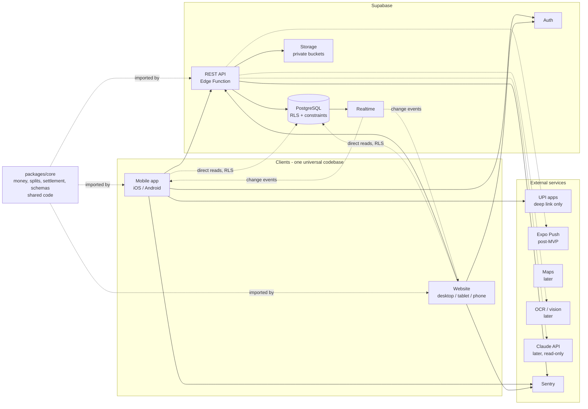
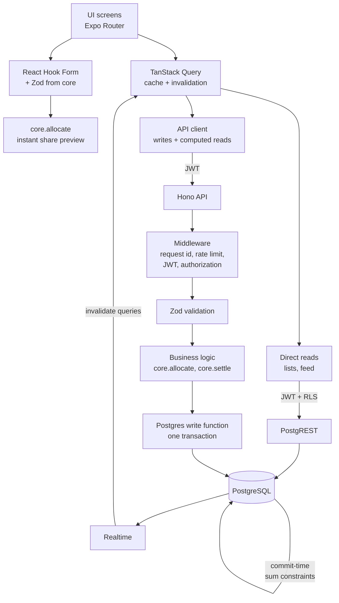
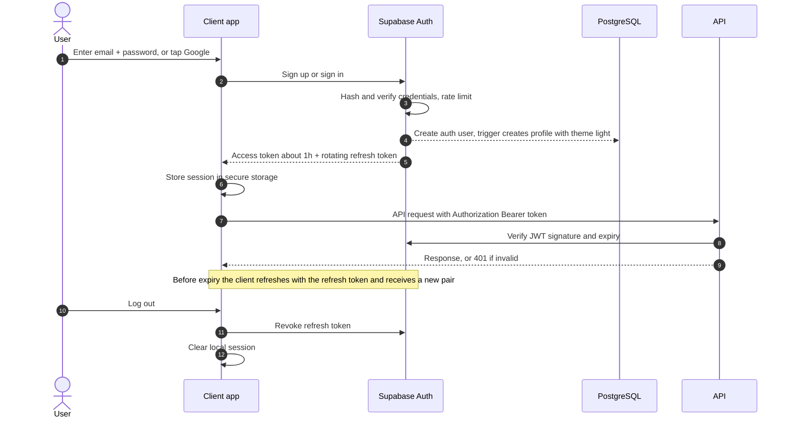
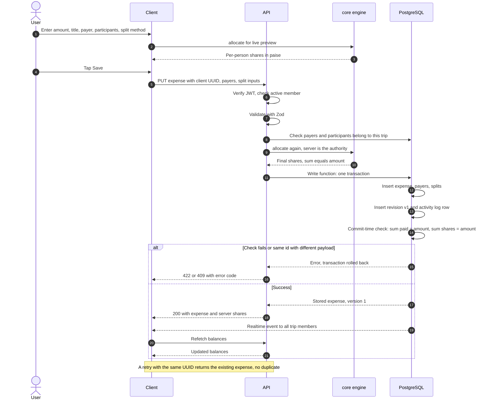
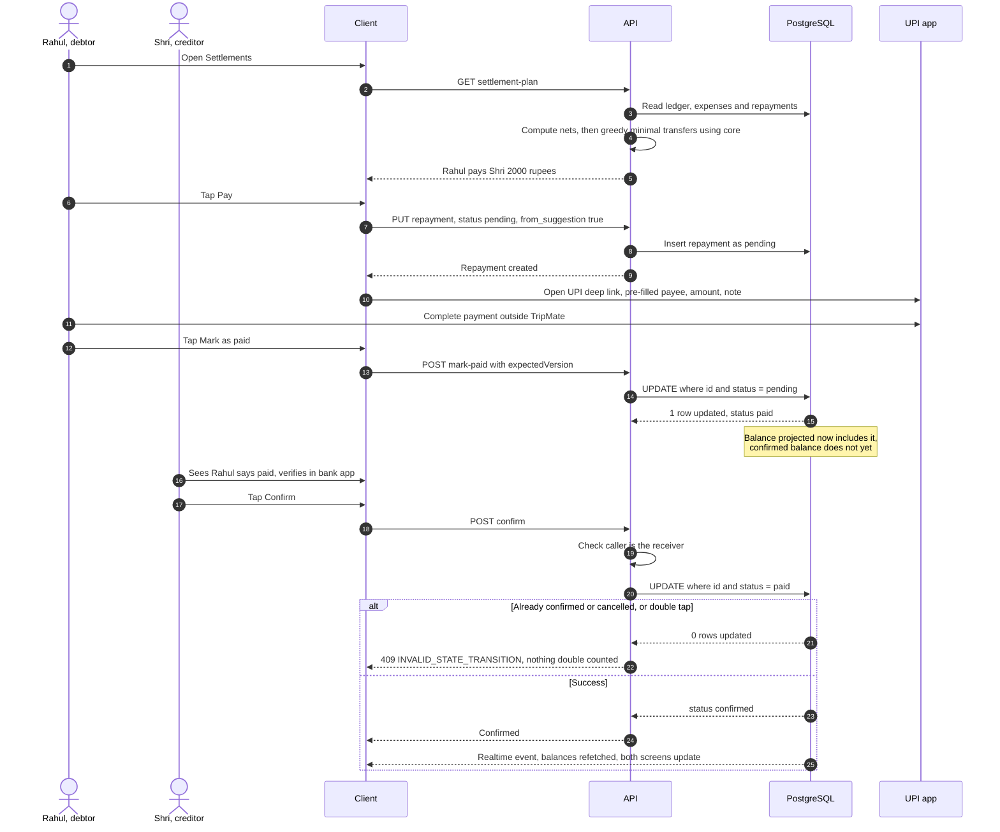
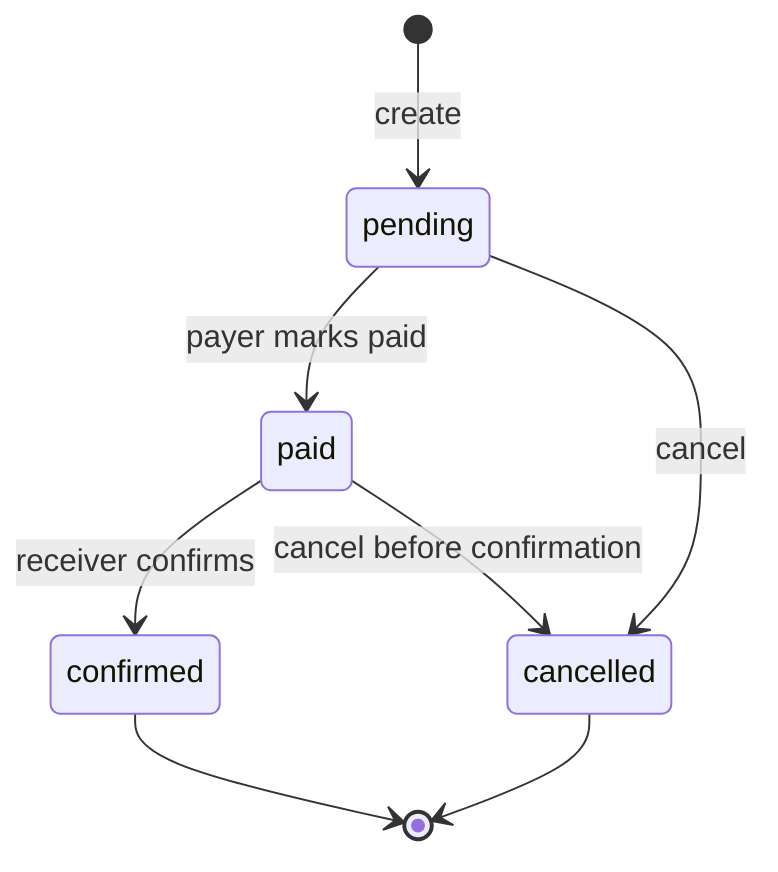
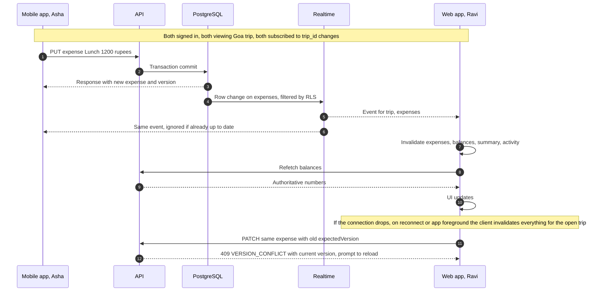
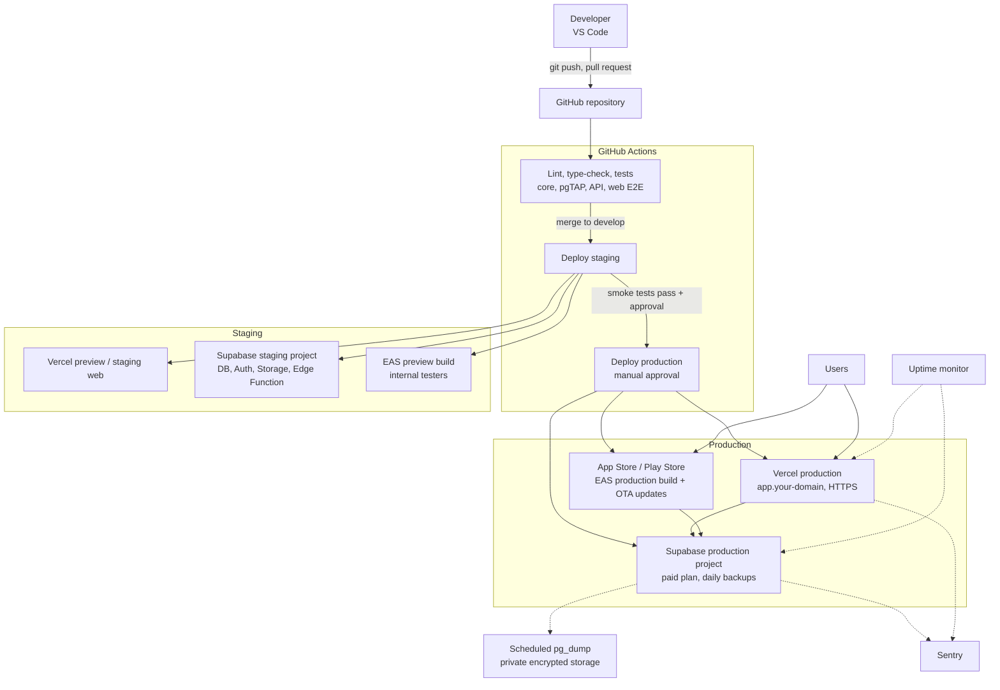

# TripMate — Architecture Diagrams

Status: **Proposed (v0.1).** All diagrams use Mermaid (rendered by GitHub and the VS Code Markdown preview with a Mermaid extension). They show the design in [SYSTEM_ARCHITECTURE.md](SYSTEM_ARCHITECTURE.md). The ERD is in [DATABASE_SCHEMA.md](DATABASE_SCHEMA.md).

Note: these were written by hand and have not yet been rendered in a Mermaid viewer. Preview them once and report any rendering errors.

---

## 1. High-level system architecture

---

## 2. Frontend, backend and database communication

---

## 3. Authentication flow

---

## 4. Expense creation and splitting flow

---

## 5. Settlement and repayment confirmation flow

State machine:

---

## 6. Mobile and web synchronization

---

## 7. Deployment architecture

