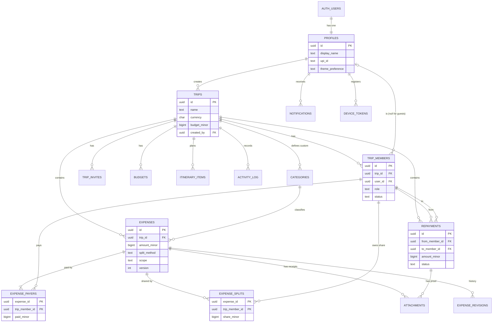

# TripMate — Database Schema

Status: **Design v0.1, being implemented one milestone at a time.** Implemented so far: `profiles` (migration `20261118000000`), `trips` + `trip_members` (migration `20261118100000`) and trip editing/archiving (migration `20261118200000`: a version trigger on `trips`, `update_trip`, `set_trip_archived`, and the internal helper `trip_role_of`; no table or policy changes). `trips.version` now adds 1 on every real change and never on a no-op. **Obligation for the expenses milestone (ADR-043): `update_trip` must refuse trip date changes that would leave an existing expense outside the trip, and expenses must be refused on archived trips.** Everything else is still design. Where the migrations differ from this document, the migrations and the decisions log win. One difference so far: trips and members are written by `create_trip()`-style database functions that check `auth.uid()` (ADR-032) rather than by an API using the service credential.

Database: PostgreSQL (managed by Supabase). See [TECH_STACK_DECISIONS.md](TECH_STACK_DECISIONS.md) and [ARCHITECTURE_DECISIONS_LOG.md](ARCHITECTURE_DECISIONS_LOG.md).

---

## 1. Conventions

| Convention | Rule |
|---|---|
| Primary keys | `uuid`. Tables where clients create rows offline-safely (expenses, repayments) take the **client-generated UUID** so retries are idempotent (ADR-009). Others use `gen_random_uuid()`. |
| Money | **`bigint` in minor units** (paise for INR). Never `float`/`numeric` for money. Column suffix `_minor`. |
| Currency | `char(3)` ISO 4217 (`INR`). MVP: one currency per trip; every amount in a trip is in the trip's currency. |
| Time | `timestamptz` (UTC). Trip dates (`start_date`, `end_date`) are `date`. |
| Deletes | Financial rows are **soft-deleted** (`deleted_at`). History is kept (ADR-008). |
| Concurrency | Mutable financial rows carry `version int` for optimistic locking (ADR-009). |
| Enums | Implemented as `text` + `CHECK` (easier to evolve than Postgres enum types). |
| Naming | `snake_case`, plural table names. |
| Security | RLS enabled on **every** table in the `public` schema. See [SECURITY_ARCHITECTURE.md](SECURITY_ARCHITECTURE.md). |

---

## 2. Entity overview

Mapping from the entities named in the brief to tables:

| Brief entity | Table(s) | Note |
|---|---|---|
| Users | `auth.users` (Supabase-managed) | Credentials live here only. |
| User profiles | `profiles` | 1:1 with `auth.users`. |
| Trips | `trips` | |
| Trip members | `trip_members` | Membership **and** identity inside a trip (supports guests and removed members). |
| Trip invitations | `trip_invites` | |
| Expenses | `expenses`, `expense_payers`, `expense_revisions` | |
| Expense participants **and** split details | `expense_splits` | One table: a participant *is* a row with a share (ADR-012). Avoids two tables drifting apart. |
| Settlements | *(computed, not stored)* | Suggested transfers are derived on demand (ADR-011). |
| Repayments | `repayments` | The real, recorded money movements between members. |
| Budgets | `trips.budget_minor` + `budgets` | |
| Itinerary items | `itinerary_items` | |
| Notifications | `notifications`, `device_tokens` | |
| Receipt attachments | `attachments` | |
| Activity history | `activity_log` | Append-only. |
| (Supporting) | `categories` | |

---

## 3. Entity Relationship Diagram



### Relationship summary

| Relationship | Type | Notes |
|---|---|---|
| `auth.users` ↔ `profiles` | **1 : 1** | `profiles.id` is both PK and FK to `auth.users.id`. |
| `profiles` → `trips` | 1 : many | `trips.created_by`. Creator is also an admin member. |
| `trips` ↔ `profiles` (via `trip_members`) | **many : many** | A user is in many trips; a trip has many users. `trip_members` is the join table and carries role/status. |
| `trips` → `expenses`, `repayments`, `budgets`, `itinerary_items`, `activity_log` | 1 : many | |
| `expenses` ↔ `trip_members` via `expense_payers` | **many : many** | Supports several payers on one expense. |
| `expenses` ↔ `trip_members` via `expense_splits` | **many : many** | Only members with a row participate and owe. |
| `repayments` → `trip_members` | many : 1 (twice) | `from_member_id` and `to_member_id`. |
| `expenses` → `attachments` | 1 : many | Receipts. |

---

## 4. Tables

### 4.1 `profiles`
**Purpose:** App-level identity and preferences for each account. 1:1 with `auth.users`.

| Column | Type | Constraints |
|---|---|---|
| `id` | uuid | **PK**, FK → `auth.users(id)` ON DELETE CASCADE |
| `display_name` | text | NOT NULL, length 1–60 |
| `avatar_path` | text | NULL (Storage path, not a public URL) |
| `upi_id` | text | NULL, format-checked (`name@bank`). Used only to build UPI deep links. |
| `preferred_currency` | char(3) | NOT NULL DEFAULT `'INR'` |
| `theme_preference` | text | NOT NULL DEFAULT `'light'`, CHECK IN (`light`,`dark`,`system`) |
| `deleted_at` | timestamptz | NULL (account anonymised, see Security doc) |
| `created_at`, `updated_at` | timestamptz | NOT NULL DEFAULT now() |

**Indexes:** PK only.
**Notes:** Default theme is `light`, matching the UI brief. A trigger creates the profile row on sign-up.

### 4.2 `trips`
**Purpose:** A group trip; the root of all shared financial data.

| Column | Type | Constraints |
|---|---|---|
| `id` | uuid | **PK** DEFAULT gen_random_uuid() |
| `name` | text | NOT NULL, 1–100 chars |
| `destination` | text | NOT NULL |
| `start_date`, `end_date` | date | NOT NULL, CHECK `end_date >= start_date` |
| `description` | text | NULL |
| `budget_minor` | bigint | NULL, CHECK `>= 0` (overall budget — the single source for the overall budget) |
| `currency` | char(3) | NOT NULL DEFAULT `'INR'`; **immutable once the trip has expenses** |
| `cover_image_path` | text | NULL |
| `status` | text | NOT NULL DEFAULT `'active'`, CHECK IN (`active`,`archived`) |
| `created_by` | uuid | NOT NULL, FK → `profiles(id)` |
| `created_at`, `updated_at` | timestamptz | |
| `version` | int | NOT NULL DEFAULT 1 |

Display states "Upcoming / Ongoing / Completed" are **derived from dates**, not stored, so they can never go stale.

**Indexes:** `(created_by)`.

### 4.3 `trip_members`
**Purpose:** Who is in a trip and in what role. Also the identity used by every expense and repayment (ADR-007).

| Column | Type | Constraints |
|---|---|---|
| `id` | uuid | **PK** DEFAULT gen_random_uuid() |
| `trip_id` | uuid | NOT NULL, FK → `trips(id)` ON DELETE CASCADE |
| `user_id` | uuid | NULL, FK → `profiles(id)`. **NULL = guest** (name-only placeholder, claimable later) |
| `display_name` | text | NOT NULL (snapshot; for guests it is the entered name) |
| `role` | text | NOT NULL DEFAULT `'member'`, CHECK IN (`admin`,`member`) |
| `status` | text | NOT NULL DEFAULT `'active'`, CHECK IN (`active`,`removed`,`left`) |
| `joined_at` | timestamptz | NOT NULL DEFAULT now() |
| `left_at` | timestamptz | NULL |
| `invited_by` | uuid | NULL, FK → `trip_members(id)` |

**Constraints:**
- `UNIQUE (trip_id, user_id) WHERE user_id IS NOT NULL` — a user appears once per trip (rejoin reactivates the same row, preserving history).
- Every trip with members must keep **≥ 1 active, signed-up admin**: enforced inside the write functions **and** by a deferred constraint trigger (`trip_members_keep_admin`, checked at commit) as the backstop (M3.4 step b).
- `CHECK (user_id IS NOT NULL OR role = 'member')` — a guest can never be an admin (`trip_members_guest_is_member`, M3.4 step b).
- Names are unique among **active** people (ignoring case and surrounding whitespace) and at most 50 people are active per trip: enforced inside the functions (not by an index, so M3.5 joins are not blocked unexpectedly).
- Rows are never deleted by any function: removing or leaving sets `status` and `left_at`. (Deviation from the earlier plan: no `removed_by` column; who removed someone is recorded in `trip_member_events`.)

**Audit table `trip_member_events` (M3.4 step b, append-only):** `id`, `seq` (strict order), `trip_id` (cascade only), `actor_member_id`, `target_member_id` (both `trip_members.id`, so no user ids), `action` (`guest_added`, `guest_renamed`, `made_admin`, `removed_admin`, `removed`, `left`), `old_value`, `new_value`, `created_at`. Readable by current members of the trip; no insert/update/delete/truncate rights for any app role; a trigger refuses update, delete and truncate for everyone (except the automatic cascade when a whole trip is removed).

**Functions (M3.4 step b), all `SECURITY DEFINER`, `search_path` pinned, `auth.uid()`, callable by signed-in users only:** `list_trip_members(trip)` (current members in full; former members with user id and role left empty), `add_guest_member(trip, name)`, `rename_guest_member(trip, member, name)`, `set_member_role(trip, member, role, expected_role)`, `remove_member(trip, member)`, `leave_trip(trip)`. Internal (not callable by the app): `member_change_context`, `name_trim`, `check_trip_has_admin`, `trip_member_events_append_only`.

**Indexes:** `(trip_id, status)`, `(user_id) WHERE status = 'active'` (the "my trips" query).

**Why `trip_members.id` instead of `user_id` everywhere else?** Removed members, guests and (later) deleted accounts all need a stable identity inside a ledger. Expenses reference `trip_members.id`, so historical balances never break when someone leaves.

### 4.4 `trip_invites`
**Purpose:** Shareable join links.

| Column | Type | Constraints |
|---|---|---|
| `id` | uuid | **PK** |
| `trip_id` | uuid | NOT NULL, FK → `trips` ON DELETE CASCADE |
| `token_hash` | text | NOT NULL, **UNIQUE** (SHA-256 of the token; the raw token is shown once and never stored) |
| `claim_member_id` | uuid | NULL, FK → `trip_members(id)` — if set, accepting the invite claims that guest member |
| `created_by` | uuid | NOT NULL, FK → `trip_members(id)` |
| `expires_at` | timestamptz | NOT NULL |
| `max_uses` | int | NOT NULL DEFAULT 1, CHECK between 1 and 50 (as built in M3.5: there is no "unlimited"; single use by default; a claim invite must be 1) |
| `use_count` | int | NOT NULL DEFAULT 0, CHECK `use_count <= max_uses` when max_uses set |
| `revoked_at` | timestamptz | NULL |
| `revoked_by` | uuid | NULL, FK → `trip_members(id)` (added in M3.5: who cancelled it) |
| `created_at` | timestamptz | |

**Indexes:** UNIQUE `(token_hash)`, `(trip_id, created_at)`.

> **Revised (2026-11-23, ADR-059, built):** general links are ONE reusable link per trip and using a link only creates an admin-approved JOIN REQUEST (new `trip_join_requests` table; `max_uses` dropped; `accept_invite` removed) by forward-only migration `20261123000000_join_requests.sql`. The text below describes migration #5 as originally applied; **the paragraphs after it ("As built, approval-based joining") are current.**

**As built (M3.5, migration `20261118400000_invitations.sql`):**
- `token_hash` is the SHA-256 (64 lower-case hex characters, checked by a constraint) of a **256-bit random token** (three random UUIDs reduced by SHA-256). The raw token is returned once by `create_invite` and never stored or logged.
- **The table has no grants and no policy for anyone**: not even the administrator who made an invitation can `SELECT` it. Everything goes through functions, so even the hash is never exposed.
- `expires_at` is 1 hour to 30 days from creation (default 7 days); `use_count <= max_uses`; `expires_at > created_at`; at most 50 outstanding invitations per trip (checked in the function).
- The audit trail `trip_member_events` gained two actions: `joined` and `guest_claimed` (`new_value` = the invitation's id, never its token).
- **Functions:** `create_invite(trip, claim_member?, expires_in_hours, max_uses)`, `list_trip_invites(trip)`, `revoke_invite(trip, invite)`, `preview_invite(token)` (**the only function callable by signed-out visitors**), `accept_invite(token)`. Internal: `invite_token_hash`.
- **Accepting:** a general link adds the person as an ordinary member under their profile name (a **returning** person gets their old row back with role reset to `member`); a claim link turns the named guest's row into the person (same member id, join date, name and role, `user_id` set) and adds nobody. Accounts are identified by user id: a matching display name never blocks joining (ADR-054).

**As built, approval-based joining (M3.5 revision, migration `20261123000000_join_requests.sql`):**
- `trip_invites` loses `max_uses` (and its constraints); `use_count` now counts the **requests made** with the link. Partial unique indexes allow **one live general link per trip** and **one live claim link per guest**; `create_invite` replaces the previous link of the same kind in the same locked transaction. A claim link is single use: usable only while `use_count = 0`. Every link made under the old rules was revoked once, when the migration first ran; memberships were untouched.
- **Reusable, copyable general link (migration #7, `20261123100000_reusable_general_link.sql`, ADR-061/062):** `trip_invites` gains `token_secret_id uuid` (the id of an **encrypted Supabase Vault secret** holding the general link's token; no foreign key, Vault is a separate schema). A check constraint `trip_invites_claim_hash_only` forbids a secret on a friend's claim link (claim links stay show-once and hash-only). The Vault secret is named `trip-invite-<invite id>` (no secret in the name). `token_hash` (SHA-256) is still what validates a link. A row-delete trigger (`trip_invites_remove_secret`, not callable by the app) removes the secret when an invitation row (or its whole trip) is deleted. `create_invite` now **refuses** a second general link while a valid one exists (`invite_exists`; an expired one is cleared away first). New `get_general_invite_link(trip)` returns the live general link's original token to an **active administrator** only. `list_trip_invites` gains `copyable`. `revoke_invite` also deletes the Vault secret.
- **`trip_join_requests`** (no grants, no policy: functions only; rows never deleted): `id`, `trip_id` (cascade), `invite_id`, `user_id` (the requester's auth id: **never returned to anyone**), `requester_name` (profile name when they asked), `claim_member_id` (null for an ordinary request), `status` (`pending` / `approved` / `rejected`), `created_at`, `decided_at`, `decided_by` (the deciding administrator's member id), `member_id` (the membership approval created, restored or claimed). A constraint keeps the decision fields consistent with the status. Unique: one **pending** request per account per trip, one **pending** claim per guest, and one request per account per **link** (decision B: after a rejection the same link cannot be used again; a replacement link can).
- **Functions** (all definer, pinned `search_path`, `auth.uid()`): `create_invite(trip, claim_member?, expires_in_hours)`, `list_trip_invites(trip)`, `revoke_invite(trip, invite)`, `preview_invite(token)` (the only signed-out function), **`request_to_join(token)`** (signed in; outcomes `requested`, `already_requested`, `already_member`; **never creates a membership**), **`list_join_requests(trip)`** (administrators; name, time, and for a claim the friend's place; no user ids), **`decide_join_request(trip, request, approve)`** (administrators; outcomes `approved`, `rejected`, `already_decided`, `already_member`).
- **Deciding** locks the trip (the member-change helper), then the request, and re-checks: still pending, trip not archived, requester's profile exists, the 50-member limit (ordinary approval), and for a claim that the guest is still an active unclaimed guest and the requester has no other row. **Approving a claim** turns that guest row into the person (same member id, name, join date, role); approving an ordinary request adds a member or restores the person's own old row with role reset to `member`. The audit event (`joined` / `guest_claimed`) has the **approving administrator as the actor** and the request id as its value.
- Expiry, revocation or replacement of a link stops new requests only; requests already made stay for an administrator to decide.

### 4.5 `categories`
**Purpose:** System and custom expense categories.

| Column | Type | Constraints |
|---|---|---|
| `id` | uuid | **PK** |
| `trip_id` | uuid | NULL, FK → `trips` ON DELETE CASCADE. **NULL = system category** |
| `key` | text | NOT NULL (stable slug, e.g. `food`) |
| `name` | text | NOT NULL |
| `icon` | text | NOT NULL (icon name from the app icon set) |
| `sort_order` | int | NOT NULL DEFAULT 0 |
| `archived_at` | timestamptz | NULL (custom categories are archived, not deleted, if in use) |

Seeded system categories (MVP): `transportation`, `accommodation`, `food`, `shopping`, `activities`, `fuel_tolls`, `other`. Indian-specific sub-categories (Feature 10) are added later as seed data, with no schema change.
**Constraints:** `UNIQUE (COALESCE(trip_id, zero-uuid), key)`.

### 4.6 `expenses`

> **M5 design (ADR-063, approved with amendments; not built yet):** the date column is `spent_on date` (not `spent_at timestamptz`), `scope` is limited to `shared` and `split_method` to `equal` by check constraints for now (widened later by forward migrations), the database derives the equal split, and the full design is in section 9.
**Purpose:** The central record: one shared (or personal) spend.

| Column | Type | Constraints |
|---|---|---|
| `id` | uuid | **PK** — **client-generated** (idempotent create) |
| `trip_id` | uuid | NOT NULL, FK → `trips(id)` ON DELETE CASCADE |
| `title` | text | NOT NULL, 1–120 chars |
| `amount_minor` | bigint | NOT NULL, CHECK `> 0` (trip currency) |
| `category_id` | uuid | NULL, FK → `categories(id)` |
| `spent_at` | timestamptz | NOT NULL |
| `notes` | text | NULL, ≤ 1000 chars |
| `scope` | text | NOT NULL DEFAULT `'shared'`, CHECK IN (`shared`,`personal`) |
| `split_method` | text | NOT NULL, CHECK IN (`equal`,`exact`,`percentage`,`shares`) |
| `created_by` | uuid | NOT NULL, FK → `trip_members(id)` |
| `updated_by` | uuid | NULL, FK → `trip_members(id)` |
| `created_at`, `updated_at` | timestamptz | |
| `version` | int | NOT NULL DEFAULT 1 |
| `deleted_at` | timestamptz | NULL |
| `deleted_by` | uuid | NULL, FK → `trip_members(id)` |

**Scope semantics (rule 9):**
- `shared` — has payers and splits, counts toward balances, visible to all members.
- `personal` — visible **only to its creator** (via RLS), has **no** payer/split rows, and is excluded from every group figure and balance. It still belongs to a trip (rule 1) so it appears in the creator's trip and personal history.

**Split methods:** "equal", "selected members only" (= equal over the chosen participants), "percentage" and "exact amount" map directly. The brief's "unequal splitting" maps to `shares` (weights, e.g. 2:1:1) in addition to `exact`. See open question Q-15.

**Indexes:**
- `(trip_id, spent_at DESC) WHERE deleted_at IS NULL` — main list and day-wise views
- `(trip_id, category_id) WHERE deleted_at IS NULL` — category breakdown
- `(trip_id, created_by)` — "my expenses" and permission checks

Multi-currency (Feature 15) later adds nullable columns (`original_amount_minor`, `original_currency`, `fx_rate`, `fx_rate_date`) **without** changing balance logic, because `amount_minor` is always in the trip's reporting currency.

### 4.7 `expense_payers`
**Purpose:** Who actually paid, and how much (supports several payers).

| Column | Type | Constraints |
|---|---|---|
| `expense_id` | uuid | FK → `expenses` ON DELETE CASCADE |
| `trip_member_id` | uuid | FK → `trip_members` |
| `paid_minor` | bigint | NOT NULL, CHECK `> 0` |
| | | **PK (`expense_id`, `trip_member_id`)** |

**Invariants (deferred constraint trigger, checked at commit):**
1. `SUM(paid_minor) = expenses.amount_minor`
2. Every payer belongs to the same trip as the expense and is an active member at write time.
3. A `shared` expense has ≥ 1 payer; a `personal` expense has none.

**Indexes:** `(trip_member_id)`.

### 4.8 `expense_splits`
**Purpose:** Participants and each participant's computed share. **A member with no row does not participate and is never charged (rule 4).**

| Column | Type | Constraints |
|---|---|---|
| `expense_id` | uuid | FK → `expenses` ON DELETE CASCADE |
| `trip_member_id` | uuid | FK → `trip_members` |
| `share_minor` | bigint | NOT NULL, CHECK `>= 0` (final computed amount) |
| `input_value` | numeric | NULL — what the user entered (percentage in basis points, share weight, exact amount) so the form can be re-opened faithfully and the UI can explain the split |
| | | **PK (`expense_id`, `trip_member_id`)** |

**Invariants (deferred constraint trigger):**
1. `SUM(share_minor) = expenses.amount_minor` — **splits add up exactly**.
2. Every participant belongs to the expense's trip.
3. A `shared` expense has ≥ 1 split row; a `personal` expense has none.

`share_minor` is always stored as the **final integer result** computed by the shared TypeScript engine; the database never re-derives it, it only verifies the sum (ADR-004, ADR-005).

**Indexes:** `(trip_member_id)`.

### 4.9 `expense_revisions`

> **M5 design (ADR-063):** the table also carries `trip_id` (composite foreign key with `expense_id`) so only ACTIVE members of the trip can read it; the snapshot holds member ids and amounts only (no user ids, emails or display names). See section 9.6.
**Purpose:** Immutable audit/history of every create, edit, delete and restore (feeds activity feed, trust features and the future dispute feature).

| Column | Type | Constraints |
|---|---|---|
| `id` | bigint | **PK** identity |
| `expense_id` | uuid | NOT NULL, FK → `expenses` ON DELETE CASCADE |
| `version` | int | NOT NULL, **UNIQUE (`expense_id`, `version`)** |
| `action` | text | NOT NULL, CHECK IN (`create`,`update`,`delete`,`restore`) |
| `snapshot` | jsonb | NOT NULL (full expense + payers + splits at that version) |
| `changed_by` | uuid | NOT NULL, FK → `trip_members(id)` |
| `changed_at` | timestamptz | NOT NULL DEFAULT now() |

Append-only: `UPDATE` and `DELETE` are revoked from all application roles.

### 4.10 `repayments`
> **M7 revision (proposed 2026-11-26, ADR-066; see `M7_REPAYMENTS_DESIGN.md` section 5):** the table below is the earlier design. The proposed M7 version has four states (`pending`, `confirmed`, `rejected`, `cancelled`; `paid` and the projected balance are dropped), `decided_by`, `decided_at` and `decision_note` instead of `paid_at`, `confirmed_at` and `cancelled_at`, no `from_suggestion`, and an append-only `repayment_events` table. Nothing here is built yet.

**Purpose:** Recorded money transfers between two members. Reduces outstanding balances according to its status.

| Column | Type | Constraints |
|---|---|---|
| `id` | uuid | **PK** — client-generated (idempotent) |
| `trip_id` | uuid | NOT NULL, FK → `trips` ON DELETE CASCADE |
| `from_member_id` | uuid | NOT NULL, FK → `trip_members` (the payer/debtor) |
| `to_member_id` | uuid | NOT NULL, FK → `trip_members` (the receiver) |
| `amount_minor` | bigint | NOT NULL, CHECK `> 0` |
| `method` | text | NOT NULL DEFAULT `'upi'`, CHECK IN (`upi`,`cash`,`bank`,`other`) |
| `note` | text | NULL (e.g. UPI reference), ≤ 200 chars |
| `status` | text | NOT NULL DEFAULT `'pending'`, CHECK IN (`pending`,`paid`,`confirmed`,`cancelled`) |
| `from_suggestion` | boolean | NOT NULL DEFAULT false (created from a suggested settlement) |
| `created_by` | uuid | NOT NULL, FK → `trip_members(id)` |
| `created_at` | timestamptz | |
| `paid_at`, `confirmed_at`, `cancelled_at` | timestamptz | NULL |
| `version` | int | NOT NULL DEFAULT 1 |

**Constraints:** `CHECK (from_member_id <> to_member_id)`; both members must belong to `trip_id`; allowed transitions only (see below).

**State machine:**

```
pending ──mark paid (by payer)──▶ paid ──confirm (by receiver)──▶ confirmed
   │                               │
   └──────────cancel───────────────┘   (cancelled is terminal; confirmed is terminal)
```

Transitions are performed with conditional updates (`UPDATE … WHERE id = $1 AND status = $2`), so two simultaneous clicks cannot double-apply (see Financial integrity §6). `cancelled` is an addition to the brief's three statuses so that mistakes can be voided without deleting history (Q-12).

**Partial repayments:** any amount `> 0` is valid; multiple repayment rows between the same pair are normal. A repayment larger than the current debt is allowed but flagged by the UI (it would flip the direction of the debt) (Q-16).

**Indexes:** `(trip_id, status)`, `(from_member_id)`, `(to_member_id)`.

### 4.11 `budgets`
**Purpose:** Sub-budgets. The **overall** budget lives on `trips.budget_minor` (one source of truth).

| Column | Type | Constraints |
|---|---|---|
| `id` | uuid | **PK** |
| `trip_id` | uuid | NOT NULL, FK → `trips` ON DELETE CASCADE |
| `scope` | text | NOT NULL, CHECK IN (`per_person`,`daily`,`category`) |
| `category_id` | uuid | NULL, FK → `categories` — required when `scope='category'`, otherwise NULL |
| `amount_minor` | bigint | NOT NULL, CHECK `>= 0` |
| `updated_at` | timestamptz | |

**Constraints:** `UNIQUE (trip_id, scope, COALESCE(category_id, zero-uuid))`.

### 4.12 `itinerary_items`
**Purpose:** Day-wise plan (post-MVP). Days are derived from `day_date`, not a separate table.

| Column | Type | Constraints |
|---|---|---|
| `id` | uuid | **PK** |
| `trip_id` | uuid | NOT NULL, FK → `trips` ON DELETE CASCADE |
| `day_date` | date | NOT NULL (must fall inside the trip's dates) |
| `title` | text | NOT NULL |
| `location_text` | text | NULL (free text for now; map coordinates added with the maps feature) |
| `start_time`, `end_time` | time | NULL |
| `notes` | text | NULL |
| `sort_order` | int | NOT NULL DEFAULT 0 |
| `created_by` | uuid | FK → `trip_members(id)` |
| `created_at`, `updated_at`, `deleted_at` | timestamptz | |

**Indexes:** `(trip_id, day_date, sort_order) WHERE deleted_at IS NULL`.
**Link to expenses (later):** a nullable `expenses.itinerary_item_id` FK, added by migration when the itinerary milestone arrives. Until then, "expenses for Day 2" is answered by `spent_at`.

### 4.13 `attachments`
**Purpose:** Receipt / payment-proof file metadata (the file itself is in private Storage).

| Column | Type | Constraints |
|---|---|---|
| `id` | uuid | **PK** |
| `expense_id` | uuid | NULL, FK → `expenses` ON DELETE CASCADE |
| `repayment_id` | uuid | NULL, FK → `repayments` ON DELETE CASCADE |
| `storage_path` | text | NOT NULL (`{trip_id}/{owner_id}/{uuid}.{ext}`) |
| `mime_type` | text | NOT NULL, CHECK IN (`image/jpeg`,`image/png`,`image/webp`,`application/pdf`) |
| `size_bytes` | int | NOT NULL, CHECK `<= 5242880` (5 MB) |
| `uploaded_by` | uuid | NOT NULL, FK → `trip_members(id)` |
| `created_at` | timestamptz | |

**Constraint:** `CHECK (num_nonnulls(expense_id, repayment_id) = 1)`.
**Indexes:** `(expense_id)`, `(repayment_id)`.

### 4.14 `activity_log`
**Purpose:** Human-readable, chronological feed per trip. Written in the **same transaction** as the change it describes, so it can never disagree with the data.

| Column | Type | Constraints |
|---|---|---|
| `id` | bigint | **PK** identity (also the stable pagination cursor) |
| `trip_id` | uuid | NOT NULL, FK → `trips` ON DELETE CASCADE |
| `actor_member_id` | uuid | NULL, FK → `trip_members(id)` |
| `type` | text | NOT NULL (e.g. `expense.created`, `expense.updated`, `expense.deleted`, `repayment.paid`, `repayment.confirmed`, `member.joined`, `member.removed`) |
| `entity_type` | text | NULL |
| `entity_id` | uuid | NULL |
| `payload` | jsonb | NOT NULL DEFAULT `{}` (e.g. title, amount, category — enough to render the sentence without joins) |
| `created_at` | timestamptz | NOT NULL DEFAULT now() |

Append-only (no UPDATE/DELETE grants).
**Indexes:** `(trip_id, id DESC)`; optional `(trip_id, actor_member_id, id DESC)` for the member filter.

### 4.15 `notifications` and `device_tokens`
**`notifications`:** `id uuid PK`, `user_id uuid FK → profiles`, `trip_id uuid NULL`, `type text`, `payload jsonb`, `read_at timestamptz NULL`, `created_at`. Index `(user_id, read_at, created_at DESC)`.
**`device_tokens`:** `id uuid PK`, `user_id uuid FK`, `expo_push_token text UNIQUE`, `platform text CHECK IN (ios,android,web)`, `last_seen_at`. Index `(user_id)`.

Both are post-MVP in use, but in the model so no restructuring is needed later.

---

## 5. Deriving balances (never stored)

Balances are **computed from the ledger** on every read (ADR-006). There is no editable "balance" column anywhere, so edits, deletes and member changes cannot leave a stale number behind.

For member `m` in trip `T`, over **non-deleted `shared`** expenses:

```
paid(m)      = Σ expense_payers.paid_minor      where trip_member_id = m
share(m)     = Σ expense_splits.share_minor     where trip_member_id = m
sent(m)      = Σ repayments.amount_minor        where from_member_id = m and status counts
received(m)  = Σ repayments.amount_minor        where to_member_id   = m and status counts

net(m) = paid(m) − share(m) + sent(m) − received(m)
         net > 0  → m should receive money
         net < 0  → m owes money
         Σ net(m) over all members of T = 0   (invariant, asserted in tests)
```

> **Superseded in part (M7 design, revision 4, approved 2026-11-26, ADR-066):** only the **confirmed, unreversed** figure is official; there is no projected figure and no `paid` state; `net(m) = expense_net(m) + confirmed_sent(m) − confirmed_received(m)`. Repayment tables, the state and reversal machines and the ten functions are specified in `M7_REPAYMENTS_DESIGN.md` sections 5 to 7 and 13; the text below is the earlier design and is rewritten when migration #12 is built.

Two figures are exposed (ADR-010; resolves open question Q-3 by providing both):

| Figure | "status counts" means | Used for |
|---|---|---|
| `net_confirmed` | `status = 'confirmed'` | Final, authoritative balance |
| `net_projected` | `status IN ('paid','confirmed')` | "Where we'll be once pending confirmations land"; default headline in the UI |

`pending` and `cancelled` never affect either figure. This directly implements rule 12 (recorded ≠ confirmed).

Implemented as a SQL view/function (`trip_member_balances`) plus the TypeScript engine in `packages/core`; a test asserts both give identical results for the same data.

---

## 6. Financial data integrity

| Requirement | Mechanism |
|---|---|
| Every expense belongs to a trip | `expenses.trip_id NOT NULL` + FK |
| Every shared expense has a valid payer | `expense_payers` rows required; constraint trigger; FK to `trip_members` of the same trip |
| Only selected participants share the cost | Only members with an `expense_splits` row are charged |
| Splits add up exactly | Deferred constraint trigger: `Σ share_minor = amount_minor` (also `Σ paid_minor = amount_minor`), checked at commit |
| Rounding handled | Integer paise; **largest-remainder allocation** in the shared TS engine (see SYSTEM_ARCHITECTURE §6) |
| Edit/delete updates balances | Balances are derived; edit = replace payer/split rows in one transaction + new revision; delete = soft delete |
| Repayments not counted twice | One row per repayment; client UUID makes retries idempotent; status transitions are conditional updates; balance formulas count each row once |
| Partial repayments | Any amount `> 0`; many rows per pair |
| Confirmed repayments update balances | `net_confirmed` includes only `confirmed`; `net_projected` includes `paid` + `confirmed` |
| Concurrent updates cannot silently corrupt | `version` column + `UPDATE … WHERE version = $expected`; mismatch ⇒ HTTP 409 and the client must refetch. Row lock (`SELECT … FOR UPDATE`) on the expense during edit. Sum invariants verified at commit regardless of races. |
| No floating point | `bigint` minor units everywhere; `number`s in TS are safe-integer checked (`Number.isSafeInteger`) at the engine boundary |
| Clients cannot bypass rules | Clients have **no direct INSERT/UPDATE/DELETE** on financial tables; only service-side write functions (ADR-004) |
| Auditable | `expense_revisions` + `activity_log`, append-only |

**Removing a member** sets `status='removed'`; their rows in payers/splits/repayments remain, so history is intact. A member with a non-zero balance **must not** be removable or able to leave once expenses exist: decided 2026-11-18 (Q-4, M3.4 D8), a **mandatory M5 requirement** (ADR-047); until M5 there are no balances, so M3.4 allows removal. Former members' rows are never deleted and are shown to current members as a name and a date only (ADR-049).

**Deleting an account** anonymises the profile and detaches `trip_members.user_id`, converting the member into a named placeholder ("Former member"); other members' ledgers are unaffected.

---

## 7. Index summary

| Table | Index | Serves |
|---|---|---|
| `trip_members` | `(trip_id, status)`; `(user_id) WHERE status='active'` | Member lists; "my trips"; RLS membership checks (hot path) |
| `trip_invites` | UNIQUE `(token_hash)` | Invite lookup |
| `expenses` | `(trip_id, spent_at DESC) WHERE deleted_at IS NULL` | Expense list, day views |
| `expenses` | `(trip_id, category_id) WHERE deleted_at IS NULL` | Category breakdown |
| `expense_payers`, `expense_splits` | `(trip_member_id)` | Per-member balance sums |
| `repayments` | `(trip_id, status)`, `(from_member_id)`, `(to_member_id)` | Settlement screen, balances |
| `activity_log` | `(trip_id, id DESC)` | Feed with cursor pagination |
| `notifications` | `(user_id, read_at, created_at DESC)` | Inbox and unread badge |

The RLS membership check (`is_trip_member(trip_id)`) runs on almost every query, so the `trip_members` index is the most important one in the system.

---

## 8. Reference data and migrations

- System categories are seed data inserted by a migration.
- Every schema change is a numbered, reviewed migration file in version control; no manual changes in the dashboard.
- Each environment (dev, staging, prod) is built **only** by applying the same migrations.
- Tests (pgTAP) must cover: sum constraints, RLS isolation between two trips, state-machine transitions, and the append-only guarantees.


---

## 9. Migration #8: expenses (M5, ADR-063) - BUILT AND TESTED LOCALLY (file `20261123200000_expenses.sql`), NOT APPLIED TO LIVE SUPABASE

Forward-only; migrations 1 to 7 stay exactly as applied. Existing functions are not rewritten.

**As built (differences from the design):** the keys that point at `trip_members` are `deferrable initially deferred` (still enforced when the change is saved) so removing a whole trip works in any cascade order; `expenses.id` is the primary key and `(id, trip_id)` is also unique; a category must be a system category or belong to the same trip (function preflight plus a trigger on `expenses`); create checks a retry (full canonical content, same creator, not deleted) BEFORE the state checks, so a retry still works after, for example, a participant left; deleting an already deleted expense and restoring one that is not deleted are safe repeats (`changed = false`), so there is no `expense_not_deleted` code; extra codes `shares_total_mismatch` (backstop) and the `net_minor=<paise>` error detail on `balance_not_settled` and `former_member_balance`.

### 9.0 Checkpoint 2 guards (migration #9, `20261124000000_expense_guards.sql`; built and tested locally, NOT applied live)
Three independent last-line guards, as triggers, for rules that migration #8 enforced only inside the functions: (1) the trip's **currency is fixed** (`trips_currency_guard`, `currency_locked`; update_trip never had a currency input); (2) an `expense_payers` or `expense_splits` row can only be **written for an active member of the same trip** (`expense_rows_member_guard`, `payer_not_active` or `participant_not_active`; stored history for people who later left is untouched); (3) the stored shares of an equal-split expense must equal the database's own derivation (`check_expense_equal_split`, deferred, `shares_not_equal_split`, runs after the sums check). No existing function or migration was rewritten.

**Migration #10 (`20261124100000_expense_row_guard_updates.sql`, local, NOT applied live):** the two row guards of migration #9 (`expense_payers_member_guard`, `expense_splits_member_guard`) now fire on `BEFORE INSERT OR UPDATE` (any column), closing a gap found in review: an UPDATE of only `paid_minor` or `share_minor` on a row whose member had left slipped past the guard (owner-only SQL; the app can never do it). The same function is used; nothing else changes. Note on migration #9's header comment: the equal-split check runs after the sums check only between triggers on the same table; across tables the order is the order the events were queued. Every check still runs at save time and any failure rolls everything back, so this only affects which error code is reported.

### 9.0b Checkpoint 5: exact, percentage and shares splits (migration #11, `20261125000000_expense_split_methods.sql`; built and tested locally, NOT applied live)
- **Methods:** `equal` (unchanged), `exact` (typed amounts that add up to the total; zero allowed), `percentage` (typed basis points, 100% = 10000, 1 to 10000 each, adding up to exactly 10000) and `shares` (typed whole weights, 1 to 1,000,000). The table check `expenses_split_method_equal_only` is replaced by `expenses_split_method_values`; `expense_splits.input_value` (already in the schema) now holds the typed value (null for equal) and must be a whole number.
- **The database derives every share** (the app sends only the method and each person's typed value). Percentage and shares use the approved largest-remainder rule with those numbers as weights: `share = floor(total x weight / sum)`, leftover paise one each to the largest remainder (`total x weight mod sum`), ties to the lowest member id as plain text in the "C" collation. Equal is the same rule with every weight 1 (tested). Exact amounts are used as typed. New internal functions (not callable by the app): `allocate_weighted`, `expense_parse_split_inputs`, `expense_derive_shares`, `expense_derive_from_request`, `expense_splits_json_v2`, `check_expense_split_inputs`; `expense_check_shape` gained the `p_split_inputs` argument.
- **Signatures:** `create_expense` and `update_expense` gain one trailing parameter `p_split_inputs jsonb default null` (`[{"member_id": "...", "value": 1234}]`, exactly the participants, strictly shaped). The old signatures are dropped; a call with the old arguments still works through the default. Grants are unchanged (signed-in users only).
- **New codes:** `split_total_mismatch` (exact amounts or percentages do not add up), `invalid_split_value` (a typed value out of range), `split_not_derived` (final guard). Retries compare the method and every typed value; history snapshots carry the typed values (`input_value` inside each split entry) and never any name or account id.
- **Final enforcement:** a deferred trigger checks that the stored shares of every non-equal expense equal what the database derives from the stored typed values, and that an equal expense holds none. Rule I-1, the locks, versions, ADR-043 and ADR-047 are unchanged and tested with the new methods.

### 9.0c M7 Checkpoint 2: repayments and reversals (migration #12, `20261126000000_repayments.sql`; built and tested locally, NOT applied live)
- **Tables:** `repayments` (four states `pending`, `confirmed`, `rejected`, `cancelled`; `amount_minor` 1 to 10^12; `method` upi, cash, bank or other; optional `note` of at most 200 characters; `created_by`, `decided_by`, `decided_at`, `decision_note`, `version`), `repayment_reversals` (`requested_by` = the authenticated actor, `requested_for` = the represented party, one of the two parties and immutable; `status` requested, override_proposed, applied, declined, withdrawn or override_refused; override fields; `is_override`), `repayment_events` (append-only; `actor_member_id` and `represented_member_id`; member ids only). Partial unique indexes allow at most one open and one applied reversal per repayment.
- **Balance:** `net = member_expense_net_minor (the M5 formula, moved unchanged) + member_repayment_adjustment_minor (confirmed_sent - confirmed_received over confirmed repayments with no applied reversal)`. `member_net_minor` keeps its signature and privileges and is now their sum, so the ADR-047 guard and Rule I-1 see repayments without being rewritten. `trip_member_balances` is recreated with `sent_minor` and `received_minor`.
- **Capacity:** `repayment_capacity(trip, from, to) = min(max(0, debt(from) - all pending repayments of from), max(0, credit(to) - all pending repayments to to))`; checked at recording and again, against the real confirmed balances, at confirmation; enforced by the functions and independently by a trigger.
- **Guards:** state-machine triggers on `repayments` and `repayment_reversals`; an after-update Rule I-1 check when a repayment is confirmed or a reversal applied; append-only events; an actor and represented-participant consistency check; and `trip_members_a_repayment_pending_guard` (an active-to-inactive change is refused while a pending repayment or an open reversal involves the member).
- **Only executable override category:** `counterparty_unresponsive` (a CHECK constraint, the function and the trigger). `counterparty_account_inaccessible` is deferred and appears nowhere in executable SQL.
- **Security:** SELECT-only RLS for active members, no write grant, every function SECURITY DEFINER with an empty `search_path`, the ten functions granted to `authenticated` only, all helpers closed. Lock order: the trip row (through `member_change_context`), then the repayment row, then the reversal row; guards only read.

### 9.1 Decisions this design implements
Database functions derive and validate equal splits; TypeScript is the reference and preview; `spent_on date`; the ADR-043 date guard considers non-deleted expenses and restore re-checks the current dates; triggers enforce ADR-043 and ADR-047 with function-level preflight; an additive unique index on `trip_members (id, trip_id)`; rule I-1 for former members; multiple payers whose amounts add up exactly to the total; first-pass splits are equal among all active members and equal among selected active members (the screen sends the explicit participant list); personal expenses and exact, percentage and shares splits are deferred.

### 9.2 Tables
| Table | Final columns and constraints |
|---|---|
| `trip_members` (existing) | **Additive only:** unique index on `(id, trip_id)` so other tables can use composite foreign keys |
| `categories` | `id`, `trip_id` (null = system), `key`, `name`, `icon`, `sort_order`, `archived_at`; unique `key` where `trip_id` is null; seeded: transportation, accommodation, food, shopping, activities, fuel_tolls, other; custom categories deferred |
| `expenses` | `id uuid` (client-generated), `trip_id`, `title` 1 to 120 (trimmed), `amount_minor bigint` 1 to 10^12, `category_id` null, `spent_on date`, `notes` up to 1000, `scope` (check = shared), `split_method` (check = equal), `created_by`, `updated_by`, `created_at`, `updated_at`, `version` default 1, `deleted_at`, `deleted_by`; unique `(id, trip_id)`; at most 2000 per trip (so sums stay far below the JavaScript safe-integer limit) |
| `expense_payers` | `expense_id`, `trip_id`, `trip_member_id`, `paid_minor > 0`; primary key `(expense_id, trip_member_id)`; composite FKs to `expenses (id, trip_id)` and `trip_members (id, trip_id)` |
| `expense_splits` | same shape with `share_minor >= 0` and `input_value` (null for equal) |
| `expense_revisions` | `id` identity, `expense_id`, `trip_id`, `version`, `action` (create, update, delete, restore), `snapshot jsonb`, `changed_by` (a trip member id), `changed_at`; unique `(expense_id, version)`; composite FK `(expense_id, trip_id)` |

Deferred constraint triggers (checked at commit): payments add up to the amount; shares add up to the amount; a shared expense has at least one payer and one split row. Indexes as in section 7.

### 9.3 Functions (all SECURITY DEFINER, `search_path = ''`, `auth.uid()`, revoked from public and anon, granted to `authenticated`)
```
create_expense(p_trip_id, p_expense_id, p_title, p_amount_minor, p_spent_on, p_category_key, p_notes,
               p_split_method, p_participants uuid[], p_payers jsonb)  -> (expense_id, version, created)
update_expense(p_trip_id, p_expense_id, p_expected_version, ...same fields...) -> (expense_id, version, changed)
delete_expense(p_trip_id, p_expense_id, p_expected_version)                    -> (expense_id, version, changed)
restore_expense(p_trip_id, p_expense_id, p_expected_version)                   -> (expense_id, version, changed)
trip_member_balances(p_trip_id) -> (member_id, paid_minor, share_minor, net_minor)   -- every member, including former
```
- **Permissions:** create: any active member; update, delete, restore: an administrator on any expense, a member only on their own; archived trips refuse every write; strangers, former members and pending requesters get `trip_not_found`.
- **`trip_member_balances` (amendment 1):** raises `not_authenticated` without a login; checks `trip_role_of(trip, auth.uid())` itself and answers `trip_not_found` unless the caller is an ACTIVE member of that trip (no reliance on row-level security); reads stay allowed on archived trips; execution is revoked from public and anon and granted to `authenticated` only.
- **Create is idempotent:** same id and identical content returns `created = false`; the same id with different content (or belonging to another trip) answers `expense_id_taken` and reveals nothing. An update that changes nothing returns `changed = false`, with no revision and no version bump.
- **Preflight (clear coded errors, before any write):** trip_not_found, not_allowed, trip_archived, expense_not_found, version_conflict, expense_deleted, expense_not_deleted, expense_id_taken, invalid_expense, payers_total_mismatch, participant_not_active, payer_not_active, outside_trip_dates, category_not_found, too_many_expenses, former_member_balance. Participants and payers must be distinct active members of the trip; on an edit the replacement lists contain active members only (which is how a former member is dropped from a historical expense).
- **Internal (not callable by the app):** `allocate_equal(total, uuid[])`, `member_net_minor(trip, member)`, `assert_member_settled(trip, member)`, `assert_expenses_within_dates(trip, start, end)`, `assert_former_members_settled(trip, member_ids)`, and the trigger functions.

### 9.4 Rules and guards (amendments 2 and 3)
- **Rounding:** `allocate_equal` gives every participant `floor(total / n)` and one extra paisa to the first `total mod n` participants ordered by `id::text collate "C"`.
- **Balance:** `net(m) = sum(paid) - sum(share)` over NON-DELETED shared expenses of the trip, former members included. Zero-sum across the trip. (M7 extends the same function with repayments and ADR-047 then tests both the confirmed and the projected figure.)
  > M7 note (revision 4.2, approved): this parenthesis is superseded. M7 keeps this formula as `member_expense_net_minor` and adds a confirmed, unreversed repayment adjustment in `member_net_minor`; there is no projected figure. Reversal rows carry `requested_by` (authenticated actor) and `requested_for` (represented party, immutable); events carry `actor_member_id` and `represented_member_id`. **Only `counterparty_unresponsive` is an executable override category in migration #12**; `counterparty_account_inaccessible` is deferred (V1).
- **Rule I-1 (final enforcement inside the write functions, after the rows are written and before commit):** for every former member (removed or left) appearing in the old OR new rows of the changed expense, `net` is recomputed over the COMPLETE resulting ledger of the trip; any non-zero value raises `former_member_balance` and the whole transaction rolls back (rows, version and revision included). Create can only involve active members, so it cannot change a former member's balance, but the check runs for uniformity.
- **ADR-047 trigger:** `BEFORE UPDATE OF status ON trip_members FOR EACH ROW WHEN (old.status = 'active' AND new.status <> 'active')` calls `assert_member_settled`; a non-zero balance raises `balance_not_settled` with the signed paise amount in the error detail. It covers `remove_member`, `leave_trip` and any other path. Claiming a guest keeps the same member row, so balances carry over and the trigger does not fire.
- **ADR-043 trigger:** `BEFORE UPDATE OF start_date, end_date ON trips FOR EACH ROW WHEN (dates changed)` calls `assert_expenses_within_dates`; only NON-DELETED expenses count; a stranded expense raises `expenses_outside_dates`. `restore_expense` re-checks the current trip dates (`outside_trip_dates`). Archiving, currency and every other column are not affected.
- **Lock ordering:** every write function takes `member_change_context` (caller checks, then the trip row `FOR UPDATE`, then the archived check), then the expense row `FOR UPDATE`; never the reverse. The guard triggers and helpers only READ (no `FOR UPDATE`, `FOR SHARE` or `LOCK`), so they add no lock, and the existing membership functions keep their order (trip lock, then member rows). A change made by direct SQL outside the functions is not serialised by the triggers (an operator action, documented as a residual).

### 9.5 Transaction sequence of an expense write
1. `auth.uid()` must not be null. 2. `member_change_context` (active member, trip locked, archived refused). 3. Lock the expense row; ownership (administrator or creator); expected version. 4. Preflight validation against the locked state. 5. Write rows, bump the version, insert the revision. 6. Rule I-1 on the complete resulting ledger. 7. At commit the deferred constraints verify the sums.

### 9.6 Revision history: access and exposure (amendment 4)
- **Read:** row-level security policy `is_trip_member(trip_id)`: ACTIVE members only. A person who left or was removed, a stranger and a pending requester see nothing, as for every other trip table.
- **Content:** the snapshot holds expense fields (title, amount, date, category key, notes, split method), payer and split rows as trip-member ids with amounts, and `changed_by` as a trip-member id. It never holds user ids, emails or display names, so names resolve through `trip_members` (which already anonymises when an account is deleted) and no personal data is frozen in history. A test pins the allowed snapshot keys.
- **Write:** no INSERT, UPDATE or DELETE grant to any app role; no write policies; an append-only trigger blocks UPDATE and DELETE (and TRUNCATE) except the automatic cascade when a whole trip is removed (the same `pg_trigger_depth() > 1` mechanism as `trip_member_events`). The same SELECT-only, members-only pattern applies to the other new tables.

### 9.7 Tests (what must exist before Checkpoint 1 is accepted)
- **Existing behaviour:** the whole existing database suite (313 tests) passes unchanged; `remove_member` and `leave_trip` with a zero balance behave and audit exactly as before; claiming a guest who has expenses keeps their balance on the same member id; source checks that the triggers and helpers contain no locks and fire only on the stated columns.
- **Access:** every caller kind for every function, including signed out; `trip_member_balances` (signed out, stranger, former, pending, active, archived trip); revision reads by active, former, stranger and pending callers; app roles cannot update or delete revisions or any financial table.
- **I-1 against the complete ledger (amendment 3):** create (a former member cannot be a payer or participant; nothing about former balances changes); edit (a zero-contribution historical expense can drop a former member; a non-zero one is refused and nothing changes, including version and revision; a seeded state where a former member already has a non-zero balance elsewhere makes even a zero-contribution edit refuse, which proves the whole ledger is used); delete and restore likewise, including restoring an expense after the person left; ADR-047 refusal with the amount in the detail; ADR-043 date change (non-deleted only, restore re-check).
- **Golden vectors (amendment 5):** one hand-verified fixture file used by both the core tests and the database tests. Each vector states the expected individual allocations AND the expected member balances after every step: exact thirds (Rs 10.00 among three = 334, 333, 333 to ids in ascending order), one paisa among three (1, 0, 0), 100 paise among seven (15, 15 then 14 five times), tie-breaking with ids mixing letters and digits, multiple payers (20000 and 10000 paid for a 30000 expense), a payer who is not a participant, a sole payer who is the sole participant, deleted then restored, a former member with a zero contribution leaving, one with a non-zero balance refused, a claimed guest, a returning member, and the 10^12 cap. Randomised parity (thousands of cases and random create, edit, delete, restore, remove and leave sequences) then asserts SQL equals TypeScript, the zero-sum invariant, I-1, ADR-043 and ADR-047 after every step.
- **Concurrency:** a real simultaneous run is not possible in the local engine, so (as in M3.5) it is covered by "second caller after the first" simulations and source checks that every write takes the trip lock first.
- **Security audit:** the function allow-list grows by the five functions; table grants are SELECT only; every function pins `search_path`; the signed-out allow-list stays `preview_invite` only; internal helpers and trigger functions are not callable by the app; mutation checks on every rule.
